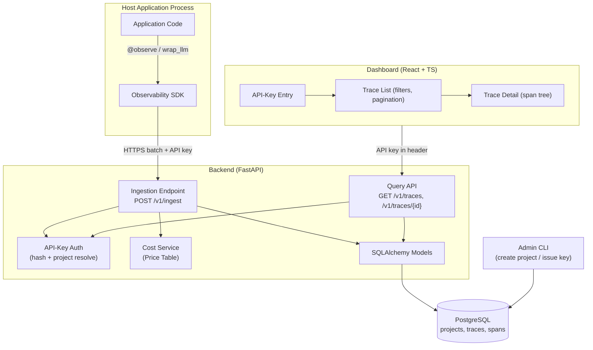
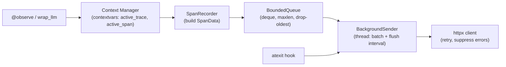
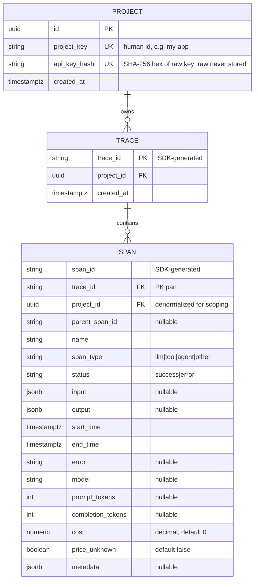

# Design Document

## Overview

The LLM Observability Platform (MVP) is a self-hostable system for inspecting the internal behavior of LLM applications. It records every request, agent step, and tool call as structured trace data with cost and latency, then presents it in a dashboard. This document describes the technical design for the three components defined in the requirements:

- **SDK** — a Python 3.12 library that instruments host application code with a decorator and an LLM-call wrapper, captures spans with timing/status/token data, and transmits them asynchronously and resiliently.
- **Backend** — a FastAPI service backed by PostgreSQL via SQLAlchemy that ingests, validates, and persists traces atomically with per-span idempotency; computes cost on ingest; and serves a query API with API-key authentication, project scoping, filtering, and cursor pagination. It ships with an Admin CLI for provisioning projects and API keys.
- **Dashboard** — a React + TypeScript single-page app that prompts for an API key, lists traces with filters and pagination, and renders each trace as a span tree with per-span and per-trace cost and latency.

The whole platform runs locally via Docker Compose (Backend, Database, Dashboard).

### Design Goals

1. **Host-app safety first.** The SDK must never break or materially slow the host application. Every failure in the SDK's record/transmit path is suppressed and the host continues.
2. **Idempotent ingestion.** The SDK generates trace and span IDs so ingestion is naturally idempotent; retries and at-least-once delivery never create duplicate spans.
3. **Correct, verifiable derivations.** Span-tree reconstruction, cost computation, idempotency, and trace status/latency are pure functions with explicit correctness properties suitable for property-based testing.
4. **Minimal operational surface.** Schema is created on first startup; provisioning is a CLI; secrets (API keys) are stored only as hashes.

### Scope

In scope: the three components, ingestion + query API, cost computation, auth, admin CLI, Docker Compose, and the tests/ADR discipline from Requirement 12.

Out of scope (unchanged from requirements): evaluation datasets, LLM-as-judge scoring, CI integration, alerting, multi-user accounts, and data masking.

### Technology Stack (fixed)

| Concern | Choice |
|---|---|
| SDK language/runtime | Python 3.12 |
| Backend framework | FastAPI |
| ORM | SQLAlchemy 2.x |
| Database | PostgreSQL |
| Dashboard | React + TypeScript |
| Local deployment | Docker Compose |
| HTTP client (SDK) | `httpx` |
| Decimal cost | Python `decimal.Decimal` ↔ PostgreSQL `NUMERIC` |

## Architecture

### Component Overview



### Data Flow: Ingestion

```mermaid
sequenceDiagram
    participant App as Host App
    participant SDK as SDK (contextvars)
    participant Q as Bounded Queue
    participant BG as Background Sender
    participant API as Ingestion Endpoint
    participant DB as PostgreSQL

    App->>SDK: call @observe fn / wrap_llm
    SDK->>SDK: start span (gen span_id, set parent from active span)
    SDK->>SDK: run fn, capture result/error, set status + end time
    SDK->>Q: enqueue span (non-blocking; drop-oldest if full)
    SDK-->>App: return result / re-raise error

    loop batch size reached OR flush interval elapsed
        BG->>Q: drain up to batch_size spans
        BG->>API: POST /v1/ingest (API key, trace+spans)
        alt success (2xx)
            API->>DB: atomic upsert (idempotent by span_id)
            API-->>BG: 2xx
        else failure / unreachable
            API-->>BG: error / timeout
            BG->>BG: retry up to max_retries, else discard batch
        end
    end

    Note over App,BG: on process exit: atexit flush within shutdown_timeout
```

### Data Flow: Query + Dashboard

```mermaid
sequenceDiagram
    participant U as Developer
    participant D as Dashboard
    participant API as Query API
    participant DB as PostgreSQL

    U->>D: enter API key
    D->>API: GET /v1/traces?status=&from=&to=&cursor= (X-API-Key)
    API->>API: resolve project by hashing key (else 401)
    API->>DB: SELECT traces WHERE project scoped, filtered, ordered desc, limit+1
    DB-->>API: rows (+ aggregated status/cost/latency)
    API-->>D: { traces[], next_cursor }
    U->>D: select a trace
    D->>API: GET /v1/traces/{id} (X-API-Key)
    API->>DB: SELECT trace + all spans (project scoped; else 404)
    DB-->>API: trace + spans
    API-->>D: trace + spans (flat list with parent_span_id)
    D->>D: reconstruct span tree (handle missing parent, self-ref, cycles)
    D->>U: render span tree + per-span/per-trace cost & latency
```

### Key Architectural Decisions

- **SDK-side ID generation.** Trace and span IDs are generated in the SDK (UUIDv4 as string). This makes ingestion idempotent: the backend upserts by `(trace_id, span_id)` so retries and at-least-once batch delivery cannot create duplicates. Rationale recorded as an ADR (see Design Decisions).
- **Context propagation via `contextvars`.** The active trace and active span are stored in `contextvars.ContextVar`. `contextvars` is natively copied across `asyncio` tasks and can be explicitly propagated to threads, satisfying async + thread attribution (Req 1.10).
- **Cost computed on ingest, stored immutably.** Span cost is computed once at ingest time from the current price table and stored as `NUMERIC`. Later price-table updates do not retroactively change stored costs (Req 4.6).
- **Trace status/latency derived, not stored redundantly.** They are computed from the trace's spans. The backend computes them in the query layer (aggregation) so they always reflect the persisted spans. A denormalized copy on the trace row is an optional optimization; the source of truth is the spans.
- **Span tree reconstructed on the client.** The backend returns spans as a flat list with `parent_span_id`; the dashboard reconstructs the tree. This keeps the backend simple and places the (property-tested) reconstruction logic where it is rendered. The same reconstruction algorithm is specified precisely so it can be property-tested independently of React.
- **Cursor pagination.** Trace listing uses a keyset (continuation token) cursor over `(start_time DESC, trace_id DESC)` rather than offset pagination, giving stable pages under concurrent inserts.

## Components and Interfaces

### 1. SDK (Python)

#### Public API Surface

```python
# observability/__init__.py

def init(
    api_key: str,
    endpoint: str,                       # Backend base URL, e.g. http://localhost:8000
    *,
    batch_size: int = 100,               # range 1..1000
    flush_interval: float = 5.0,         # seconds, range 1..60
    queue_capacity: int = 10_000,        # range 100..100_000
    max_retries: int = 3,                # range 0..10
    shutdown_timeout: float = 5.0,       # seconds
) -> None:
    """Configure the global client and start the background sender.
    Registers an atexit flush hook. Safe to call once at startup."""

def observe(
    name: str | None = None,             # defaults to the function's __name__
    span_type: str = "other",            # one of: llm, tool, agent, other
    capture_io: bool = True,
):
    """Decorator. Records the decorated function's execution as a span in the
    current trace. Works on sync and async functions. On no active trace,
    starts a new trace and records the span as the root span."""

def wrap_llm(
    fn: Callable,                        # the underlying LLM call
    *,
    name: str | None = None,
    extract_usage: Callable[[Any], Usage] | None = None,
):
    """Returns a wrapped callable that records the call as a span of type 'llm'.
    If the result (or extract_usage) reports a model id and token counts, they
    are captured; otherwise those fields are left absent and recording still
    succeeds."""

@dataclass
class Usage:
    model: str | None = None
    prompt_tokens: int | None = None
    completion_tokens: int | None = None

def flush(timeout: float | None = None) -> None:
    """Best-effort synchronous flush of the queue. Never raises."""
```

#### Internal Structure



- **Context (`contextvars`).** `active_trace: ContextVar[TraceContext | None]` and `active_span: ContextVar[SpanContext | None]`. On entering a span: generate `span_id`; if no active trace, generate `trace_id` and mark this span as root (no `parent_span_id`); else set `parent_span_id` to the active span's id. Save a token and reset to the previous active span on exit (Req 1.3, 1.4). Because `contextvars` propagate across `asyncio` tasks automatically and are copied explicitly for threads, attribution is correct across async/thread boundaries (Req 1.10).
- **SpanRecorder.** Captures `name`, `span_type`, `input`, `output`, `start_time`, `end_time`, `status`. On exception: set status `error`, capture error string, record end time, then re-raise (Req 1.6). For LLM spans, capture `model`/`prompt_tokens`/`completion_tokens` when reported, else leave absent (Req 1.7, 1.8).
- **BoundedQueue.** Backed by a `collections.deque(maxlen=queue_capacity)` guarded by a lock. Enqueue is non-blocking; when full, appending to a `maxlen` deque evicts the oldest item (drop-oldest, Req 2.4).
- **BackgroundSender.** A daemon thread. Sends a batch when queued spans reach `batch_size` or when `flush_interval` elapses, whichever first (Req 2.2). Spans are grouped by `trace_id` into ingest requests. On transmission failure, retry up to `max_retries`, then discard the batch (Req 2.5). On unreachable backend, retain data in the queue and let the host continue (Req 2.3). All exceptions in the transmit path are caught and suppressed (Req 2.6).
- **Shutdown.** An `atexit` hook calls `flush(shutdown_timeout)`; the process is allowed to exit whether or not the flush completes (Req 2.8).

#### Error Suppression Boundary

The only error the SDK propagates to the host is an exception raised *by the host's own decorated/wrapped function* (re-raised after recording). Everything else — serialization, enqueue, batching, HTTP, retries, flush — is wrapped in a guard that logs at debug level and returns, never raising into the host path (Req 2.6).

### 2. Backend (FastAPI + SQLAlchemy + PostgreSQL)

#### Authentication

- API key presented in the `X-API-Key` header (Req 6.2).
- Missing key → `401` "authentication credentials are missing" (Req 6.3).
- The backend hashes the presented key (SHA-256 over the raw key) and looks up a project by `api_key_hash` (Req 6.4). No match → `401` "invalid credentials" without disclosing whether key or project is the cause (Req 6.5).
- A resolved `project_id` scopes every subsequent DB access (Req 6.6, 6.7).
- Raw keys are never stored; only `api_key_hash` (Req 6.1). API keys carry a fixed prefix (`lop_`) to aid recognition; the hash is computed over the whole raw key.

A FastAPI dependency `require_project(x_api_key: str = Header(...))` returns the resolved `Project` or raises the appropriate `HTTPException`.

#### Ingestion Endpoint

```
POST /v1/ingest
Headers: X-API-Key: <raw key>
Body (application/json):
{
  "trace_id": "4b1c...",                      // SDK-generated, required
  "spans": [                                   // 1..1000 spans
    {
      "span_id": "a1...",                      // SDK-generated, required, unique within trace
      "parent_span_id": "9f..." | null,
      "name": "retrieve_docs",                 // non-empty, required
      "span_type": "tool",                     // llm|tool|agent|other, required
      "input": { ... } | "...",                // optional; serialized size <= max_payload (64KB)
      "output": { ... } | "...",               // optional; serialized size <= max_payload (64KB)
      "start_time": "2025-01-01T00:00:00.000Z",// required
      "end_time":   "2025-01-01T00:00:01.000Z",// required, >= start_time
      "status": "success",                     // success|error, required
      "error": "..." | null,
      "model": "gpt-4o" | null,
      "prompt_tokens": 1234 | null,
      "completion_tokens": 567 | null,
      "metadata": { ... } | null
    }
  ]
}
```

Processing order (fail fast, no partial writes):

1. **Auth** → resolve project or `401` (Req 3.3).
2. **Parse/shape** → body not parseable as trace data, or `> 1000` spans → `400` with reason (Req 3.9). Fewer than 1 span → `400`.
3. **Per-field size** → any span `input`/`output` serialized size `> max_payload_bytes` (default 65536) → `413` naming the span and field (Req 3.11).
4. **Field validation** → missing `trace_id`; per span: missing `span_id`, empty `name`, invalid `span_type`, missing `start_time`/`end_time`, `end_time < start_time`, invalid `status` → `422` naming the span index and field (Req 3.4, 3.5).
5. **Cost** → for each `llm` span with `model` + both token counts present, compute cost from the price table; else cost `0` (and price-unknown flag when model missing from table) (Req 3.7, 4.2–4.4).
6. **Atomic persist** → within one transaction, upsert the trace row and all spans, idempotent by `(trace_id, span_id)`: existing spans are left untouched (not duplicated, not overwritten). Either all new spans commit or none do (Req 3.6, 3.10).
7. **Respond** → `2xx` (Req 3.8, 3.10).

Response:

```json
{ "trace_id": "4b1c...", "spans_received": 12, "spans_persisted": 10, "spans_ignored_duplicate": 2 }
```

Validation errors use a consistent envelope:

```json
{ "error": { "code": "validation_error", "message": "...", "span_index": 3, "field": "end_time" } }
```

#### Query API

```
GET /v1/traces
Headers: X-API-Key: <raw key>
Query params:
  status: "success" | "error"            (optional; other value -> 400)
  from:   ISO-8601 timestamp             (optional time-range start bound)
  to:     ISO-8601 timestamp             (optional time-range end bound)
  limit:  int (default 50, max 100)
  cursor: opaque continuation token      (optional)
```

Response:

```json
{
  "traces": [
    {
      "trace_id": "4b1c...",
      "start_time": "2025-01-01T00:00:00.000Z",
      "end_time":   "2025-01-01T00:00:03.250Z",
      "status": "error",
      "cost": "0.0123",
      "latency_ms": 3250,
      "span_count": 12
    }
  ],
  "next_cursor": "eyJzdCI6..." 
}
```

- Project-scoped; `401` on missing/invalid key (Req 5.2).
- Ordered by `start_time DESC`, tie-broken by `trace_id DESC`; page size default 50, max 100; `next_cursor` returned when more rows exist (Req 5.1, 5.11).
- `status` filter: only matching trace status; unrecognized value → `400` naming the invalid filter (Req 5.4, 5.5).
- Time-range filter: `start_time` between `from` and `to` inclusive; `from > to` or an invalid timestamp → `400` naming the invalid range (Req 5.6, 5.7).
- Combined filters apply conjunctively.
- Each trace includes derived `status`, `cost`, `latency_ms` (Req 5.3, 5.12).

```
GET /v1/traces/{trace_id}
Headers: X-API-Key: <raw key>
```

Response:

```json
{
  "trace_id": "4b1c...",
  "status": "error",
  "cost": "0.0123",
  "latency_ms": 3250,
  "start_time": "...",
  "end_time": "...",
  "spans": [
    {
      "span_id": "a1...",
      "parent_span_id": "9f..." ,
      "name": "retrieve_docs",
      "span_type": "tool",
      "status": "success",
      "input": { ... },
      "output": { ... },
      "start_time": "...",
      "end_time": "...",
      "latency_ms": 42,
      "error": null,
      "model": "gpt-4o",
      "prompt_tokens": 1234,
      "completion_tokens": 567,
      "cost": "0.0098",
      "price_unknown": false,
      "metadata": { ... }
    }
  ]
}
```

- Returns all spans with every field listed in Req 5.8.
- Trace not found, or found but belonging to another project → `404` (indistinguishable to avoid leaking existence) (Req 5.9, 5.10, 6.7).
- The backend returns spans as a **flat list**; the client reconstructs the tree (Req 9/10).

#### Cost Service

```python
# backend/cost.py
from decimal import Decimal

@dataclass(frozen=True)
class ModelPrice:
    prompt_price: Decimal        # per prompt token, >= 0
    completion_price: Decimal    # per completion token, >= 0

class PriceTable:
    def __init__(self, prices: dict[str, ModelPrice]): ...
    def get(self, model: str | None) -> ModelPrice | None: ...

@dataclass(frozen=True)
class CostResult:
    cost: Decimal                # 0 when unknown/missing
    price_unknown: bool          # True only when model present but absent from table

def compute_span_cost(
    model: str | None,
    prompt_tokens: int | None,
    completion_tokens: int | None,
    table: PriceTable,
) -> CostResult:
    """
    - model absent OR a token count missing -> CostResult(Decimal(0), price_unknown=False)  (Req 4.4)
    - model present but not in table         -> CostResult(Decimal(0), price_unknown=True)   (Req 4.3)
    - model present and in table             -> prompt*prompt_price + completion*completion_price (Req 4.2)
    """
```

The price table is loaded from configuration (JSON/env). Trace cost is the sum of span costs (Req 4.5). All arithmetic uses `Decimal`; the column type is `NUMERIC` (Req 4.1).

#### Schema Creation on Startup

On startup the backend runs `Base.metadata.create_all()` (idempotent) within a guarded step before serving. If schema creation fails, it reports the error, leaves no partial schema (transactional DDL / rollback), and does not accept requests (Req 11.4, 11.5). A `GET /healthz` returns ready only after schema creation succeeds (used by Compose health checks, Req 11.2, 11.3).

### 3. Admin CLI

A small `argparse`/`typer`-based script invoked by an operator (e.g. `python -m backend.admin ...` or inside the backend container).

```
# Create a project and issue its one API key
admin project create --id <project_id>
  -> creates project with a unique id (Req 7.1)
  -> generates a raw API key, stores only its hash, prints the raw key ONCE (Req 7.2, 7.3)
  -> if <project_id> already exists: error, no duplicate created (Req 7.4)

# List projects (no secrets)
admin project list
  -> prints project ids and created-at; never prints keys or hashes

# Rotate the API key for a project (issues a new key, replaces the stored hash)
admin project rotate-key --id <project_id>
  -> prints the new raw key ONCE; invalidates the old hash
```

Example output on create:

```
Created project "my-app".
API key (shown once, store it now): lop_7b1f9c2e... 
```

The raw key is generated with `secrets.token_urlsafe`, hashed with SHA-256, and only the hash is persisted; the CLI never logs the raw key (Req 7.3).

## Data Models

### Entity Relationship



### Table: `projects`

| Column | Type | Constraints | Notes |
|---|---|---|---|
| `id` | `UUID` | PK | internal id |
| `project_key` | `TEXT` | UNIQUE, NOT NULL | operator-chosen identifier (Req 7.1, 7.4) |
| `api_key_hash` | `TEXT` | UNIQUE, NOT NULL | SHA-256 hex of the raw key; **raw key never stored** (Req 6.1) |
| `created_at` | `TIMESTAMPTZ` | NOT NULL, default now | |

`api_key_hash` is indexed (UNIQUE) so project resolution by hashing the presented key is a single indexed lookup (Req 6.4).

### Table: `traces`

| Column | Type | Constraints | Notes |
|---|---|---|---|
| `trace_id` | `TEXT` | PK | SDK-generated (Req 1.9, 3.4) |
| `project_id` | `UUID` | FK → projects.id, NOT NULL | scoping (Req 6.6) |
| `created_at` | `TIMESTAMPTZ` | NOT NULL, default now | ingestion time |

Trace `start_time`, `end_time`, `status`, `cost`, and `latency` are **derived** from spans (Req 5.12, 4.5) and computed in the query layer. Index on `(project_id, trace_id)`. For list ordering/filtering by trace start time, the query derives `MIN(span.start_time)` per trace; a denormalized `start_time`/`end_time` on the trace row (maintained at ingest) is an allowed optimization and, if added, is indexed as `(project_id, start_time DESC, trace_id DESC)` to serve keyset pagination efficiently.

### Table: `spans`

| Column | Type | Constraints | Notes |
|---|---|---|---|
| `span_id` | `TEXT` | part of PK | SDK-generated (Req 1.9) |
| `trace_id` | `TEXT` | FK → traces.trace_id, part of PK | |
| `project_id` | `UUID` | FK → projects.id, NOT NULL | denormalized for scoping (Req 6.6) |
| `parent_span_id` | `TEXT` | NULL | absent ⇒ candidate root (Req 1.3, 10.3) |
| `name` | `TEXT` | NOT NULL, non-empty | (Req 3.4) |
| `span_type` | `TEXT` | NOT NULL, CHECK in (`llm`,`tool`,`agent`,`other`) | (Req 3.4) |
| `status` | `TEXT` | NOT NULL, CHECK in (`success`,`error`) | (Req 3.4) |
| `input` | `JSONB` | NULL | serialized size ≤ 64KB (Req 3.11) |
| `output` | `JSONB` | NULL | serialized size ≤ 64KB (Req 3.11) |
| `start_time` | `TIMESTAMPTZ` | NOT NULL | (Req 3.4) |
| `end_time` | `TIMESTAMPTZ` | NOT NULL, CHECK `end_time >= start_time` | (Req 3.4) |
| `error` | `TEXT` | NULL | present for error spans (Req 1.6, 5.8) |
| `model` | `TEXT` | NULL | (Req 1.7, 1.8) |
| `prompt_tokens` | `INTEGER` | NULL | (Req 1.7) |
| `completion_tokens` | `INTEGER` | NULL | (Req 1.7) |
| `cost` | `NUMERIC(20,10)` | NOT NULL, default `0` | decimal precision (Req 4.1) |
| `price_unknown` | `BOOLEAN` | NOT NULL, default `false` | set when model absent from price table (Req 4.3, 9.9) |
| `metadata` | `JSONB` | NULL | (Req 5.8) |

**Primary key:** `(trace_id, span_id)`. This composite PK is the idempotency key: upsert-on-conflict-do-nothing guarantees a duplicate `span_id` within a trace is ignored, never stored twice (Req 3.10, 10.2). `span_id` uniqueness is scoped to its trace (Req 1.9). Index on `(trace_id)` for single-trace fetch; index on `(project_id)` for scoping.

### DTOs / Wire Shapes

- **IngestRequest / IngestSpan** (Pydantic models) mirror the ingestion body above and enforce types, enum membership, non-empty name, and `end_time >= start_time` at the validation layer, mapping failures to `422` (Req 3.4, 3.5).
- **TraceSummary** and **TraceDetail / SpanOut** mirror the query responses.
- **Cursor**: an opaque base64url token encoding `{ start_time, trace_id }` of the last row in the current page; decoded server-side for keyset pagination (Req 5.1, 5.11). A malformed cursor → `400`.

### Span-Tree Reconstruction (client algorithm, precisely specified)

Given the flat span list of a trace, the dashboard builds the tree as follows (drives Req 10 properties):

1. Index spans by `span_id`.
2. For each span, determine its effective parent:
   - If `parent_span_id` is absent → **root**.
   - If `parent_span_id == span_id` (self-reference) → **root** (Req 10.5).
   - If `parent_span_id` does not match any span in the trace → **root** (Req 10.4).
   - Otherwise its parent is the referenced span (tentatively).
3. **Cycle breaking:** walking parent links from a span, if a span would revisit an ancestor already on its chain, the first span on that chain whose parent is already an ancestor is promoted to a **root**, so the result has no cycles (Req 10.6).
4. Attach each non-root span under its effective parent; collect roots.
5. **Ordering:** children of every node (and the roots) are ordered by ascending `start_time`, ties broken by ascending `span_id` (Req 10.7).
6. Every span appears exactly once (as a root or under exactly one parent) (Req 10.1–10.3).

This algorithm is extracted into a pure function `buildSpanTree(spans): TreeNode[]` so it can be property-tested independent of rendering.

## Correctness Properties

*A property is a characteristic or behavior that should hold true across all valid executions of a system — essentially, a formal statement about what the system should do. Properties serve as the bridge between human-readable specifications and machine-verifiable correctness guarantees.*

The following properties are derived from the acceptance criteria and drive property-based testing. Properties are grouped by concern. Each is universally quantified and annotated with the requirements it validates.

**Group: Span-Tree Reconstruction**

### Property 1: Forest well-formedness

*For any* set of spans belonging to a single trace (including spans with absent, self-referencing, dangling, or cyclic `parent_span_id` values), the reconstructed span tree is a forest in which every span of the trace appears exactly once, the forest contains no cycles, and a span is a root if and only if its `parent_span_id` is absent, equals its own id, references no span in the trace, or was promoted to a root to break a cycle.

**Validates: Requirements 10.2, 10.3, 10.4, 10.5, 10.6**

### Property 2: Non-root parent placement

*For any* set of spans, every non-root span in the reconstructed tree is placed directly beneath the span identified by its effective `parent_span_id` (the existing, non-self, non-cycle parent).

**Validates: Requirements 10.1, 9.1**

### Property 3: Deterministic sibling ordering

*For any* parent node (and the set of roots) in the reconstructed tree, its children are ordered by ascending span `start_time`, with ties broken by ascending `span_id`.

**Validates: Requirements 10.7**

**Group: Cost Computation**

### Property 4: Span cost is a total function with exact decimal arithmetic

*For any* span, the computed span cost and price-unknown flag satisfy: (a) if the model is present in the price table and both token counts are present, the cost equals `prompt_tokens * prompt_price + completion_tokens * completion_price` computed in exact decimal arithmetic with no floating-point drift and `price_unknown` is false; (b) if the model is present but absent from the price table, the cost is exactly zero and `price_unknown` is true; (c) if the model is absent or either token count is missing, the cost is exactly zero and `price_unknown` is false.

**Validates: Requirements 3.7, 4.1, 4.2, 4.3, 4.4**

### Property 5: Trace cost is the sum of span costs

*For any* trace, the computed trace cost equals the exact decimal sum of the costs of all its spans, and is zero when the trace has no spans with non-zero cost.

**Validates: Requirements 4.5**

### Property 6: Stored cost is immutable across price-table updates

*For any* span ingested under a price table, changing the price table afterward leaves that span's stored cost unchanged, while spans ingested after the change use the updated prices.

**Validates: Requirements 4.6**

**Group: Idempotent and Atomic Ingestion**

### Property 7: Ingestion is idempotent by (trace_id, span_id)

*For any* valid ingest payload, ingesting it and then ingesting the same or an overlapping set of spans (in any order, any number of times) results in a stored span set equal to the set-union keyed by `(trace_id, span_id)`: duplicate spans create no second stored copy, no stored span is overwritten, and every such request returns a 2xx status.

**Validates: Requirements 3.10**

### Property 8: Valid ingestion is atomic and preserves parent references

*For any* valid ingest payload, after a successful ingest all of its spans are persisted with their `parent_span_id` preserved and return 2xx; and if a failure occurs during persistence, none of the request's spans are persisted (all-or-none).

**Validates: Requirements 3.6, 3.8**

### Property 9: Invalid spans are rejected atomically and identified

*For any* ingest payload in which exactly one span violates a field rule (missing/empty name, invalid `span_type`, missing or absent `trace_id`/`span_id`, missing times, `end_time` earlier than `start_time`, or invalid `status`), the request is rejected with HTTP 422, the error names the offending span and field, and no span from the request is persisted.

**Validates: Requirements 3.4, 3.5**

### Property 10: Malformed or oversize requests are rejected without persistence

*For any* ingest request whose body cannot be parsed as trace data or that contains more than 1000 (or fewer than 1) spans, the backend responds 400 and persists nothing; and *for any* span whose `input` or `output` serialized size exceeds the configured per-field limit, the backend responds 413 naming the offending span and field and persists nothing.

**Validates: Requirements 3.1, 3.9, 3.11**

**Group: Trace Status and Latency Derivation**

### Property 11: Trace status and latency derivation

*For any* non-empty trace, the derived trace status is `error` if and only if at least one of its spans has status `error` (otherwise `success`), and the derived trace latency equals the difference between the maximum span `end_time` and the minimum span `start_time` across all spans in the trace.

**Validates: Requirements 5.12**

**Group: Authentication and Project Scoping**

### Property 12: API-key resolution round-trip

*For any* project provisioned with a generated API key, presenting that raw key resolves to exactly that project (the stored `api_key_hash` equals the hash of the presented key), and the raw key is never present in storage.

**Validates: Requirements 3.2, 6.1, 6.4**

### Property 13: Project isolation

*For any* two distinct projects with their own data, a request authenticated with one project's key can read and write only that project's traces and spans, and never observes or modifies the other project's data.

**Validates: Requirements 6.6**

### Property 14: Missing or invalid credentials are rejected without data

*For any* ingestion or query request whose API key is missing or matches no project, the backend responds 401 and returns or persists no trace data, with a message that does not disclose whether the key or the project is the cause.

**Validates: Requirements 3.3, 5.2, 6.3, 6.5**

### Property 15: Cross-project or unknown trace fetch yields not-found

*For any* single-trace fetch whose trace id does not exist or belongs to a project other than the one resolved from the API key, the backend responds 404 and returns no trace or span data.

**Validates: Requirements 5.9, 5.10, 6.7**

**Group: Query Listing, Filtering, and Pagination**

### Property 16: Listing is ordered and pages partition the result set

*For any* set of traces for a project and any page size within `[1, 100]`, paging through the trace list using continuation tokens yields every scoped trace exactly once with no gaps or duplicates, the concatenation is ordered by `start_time` descending (ties by `trace_id` descending), each page contains at most the page-size rows, and a continuation token is present if and only if more rows remain.

**Validates: Requirements 5.1, 5.11**

### Property 17: Status filter correctness

*For any* status filter value `success` or `error`, the returned traces are exactly the scoped traces whose derived status equals the filter value.

**Validates: Requirements 5.4**

### Property 18: Time-range filter correctness

*For any* valid time range `[from, to]`, the returned traces are exactly the scoped traces whose `start_time` is greater than or equal to `from` and less than or equal to `to`.

**Validates: Requirements 5.6**

### Property 19: Trace list and detail field completeness

*For any* returned trace summary, the row includes the trace identifier, start time, end time, derived status, derived cost, and derived latency; and *for any* single-trace fetch, every span is returned exactly once with all of: name, type, input, output, start time, end time, status, error, model, prompt token count, completion token count, cost, `parent_span_id`, and metadata.

**Validates: Requirements 5.3, 5.8**

**Group: SDK Resilience**

### Property 20: Parent attribution follows the active span

*For any* nesting of decorated/wrapped calls, a span executed with no active trace is recorded as a root of a newly generated trace, a span executed within an active trace is recorded with `parent_span_id` equal to the enclosing active span's id, and the active span is restored to the previous one when each span ends.

**Validates: Requirements 1.3, 1.4, 1.10**

### Property 21: Identifier uniqueness

*For any* sequence of recorded spans, all span ids within a trace are distinct, and each newly started trace receives a distinct trace id.

**Validates: Requirements 1.9**

### Property 22: Errors are recorded and re-raised

*For any* decorated or wrapped callable that raises, the recorded span has status `error`, a captured error, and a recorded end time, and the original exception propagates unchanged to the host application.

**Validates: Requirements 1.6**

### Property 23: Bounded queue drops oldest under overflow

*For any* queue capacity `C` and any sequence of `N > C` enqueues performed while the sender is stalled, the queue size never exceeds `C` and its final contents are exactly the most recent `C` enqueued spans (oldest dropped).

**Validates: Requirements 2.4**

### Property 24: Bounded retries then discard; host unaffected

*For any* configured maximum retry count `m`, a batch whose transmission persistently fails is attempted at most `m + 1` times and then discarded, and no exception from the transmission path propagates to the host application.

**Validates: Requirements 2.5, 2.6**

### Property 25: Transmission carries the API key

*For any* batch the SDK transmits, the outgoing request includes the configured API key for backend authentication.

**Validates: Requirements 2.7**

## Error Handling

### Backend HTTP Status Mapping

| Condition | Status | Body | Requirements |
|---|---|---|---|
| Missing API key | `401` | `{error:{code:"missing_credentials", message}}` | 6.3 |
| Invalid API key (no project) | `401` | `{error:{code:"invalid_credentials", message}}` (non-disclosing) | 3.3, 5.2, 6.5 |
| Body not parseable as trace data | `400` | `{error:{code:"bad_request", message}}` | 3.9 |
| More than 1000 (or fewer than 1) spans | `400` | `{error:{code:"span_count_out_of_range", message}}` | 3.1, 3.9 |
| Invalid status/time-range filter | `400` | `{error:{code:"invalid_filter", field, message}}` | 5.5, 5.7 |
| Malformed continuation cursor | `400` | `{error:{code:"invalid_cursor", message}}` | 5.1, 5.11 |
| Field validation failure | `422` | `{error:{code:"validation_error", span_index, field, message}}` | 3.4, 3.5 |
| `input`/`output` over per-field size limit | `413` | `{error:{code:"payload_too_large", span_index, field, message}}` | 3.11 |
| Trace not found / cross-project | `404` | `{error:{code:"not_found", message}}` | 5.9, 5.10, 6.7 |
| Valid ingest / valid query | `2xx` | success body | 3.8, 3.10, 5.x |

Principles:
- **Fail before writing.** All auth, shape, size, and field validation happen before any DB write, so a rejected request persists nothing (Req 3.5, 3.9, 3.11).
- **Atomic persistence.** The trace and its spans commit in a single transaction; any persistence error rolls back the whole request (Req 3.6).
- **Non-disclosure.** `401` for an unknown key and `404` for a cross-project trace are deliberately generic so they do not reveal whether a key, project, or trace exists (Req 6.5, 6.7).
- **Schema-creation failure.** If first-startup schema creation fails, the backend reports the error, rolls back to leave no partial schema, and refuses to serve ingestion/query (Req 11.5); `/healthz` stays not-ready.

### SDK Failure Suppression

- The SDK exposes exactly one failure to the host: an exception raised by the host's own decorated/wrapped function, which is re-raised after the span is recorded (Req 1.6).
- Every other operation — building span data, serialization, enqueue, batching, HTTP transmission, retry, flush, shutdown — is wrapped in a guard that catches all exceptions, logs at debug level, and returns. No internal SDK error reaches the host path (Req 2.6).
- Backend unreachable: the batch is retained/retried and the host continues (Req 2.3). Queue full: the oldest span is dropped and the host continues (Req 2.4). Retries exhausted: the batch is discarded and the host continues (Req 2.5).
- Missing LLM usage data (no model/token counts) is not an error: the fields are left absent and the span is still recorded (Req 1.8).
- Process exit: a best-effort flush runs within the shutdown timeout and the process is allowed to exit regardless of flush completion (Req 2.8).

## Testing Strategy

The platform uses a **dual testing approach**: property-based tests verify the universal properties above across many generated inputs, and example/unit/integration tests cover specific scenarios, edge cases, UI rendering, and infrastructure wiring. This satisfies Requirement 12's required tests.

### Property-Based Testing

- **Library.** Python backend/SDK: **Hypothesis**. Dashboard (TypeScript): **fast-check**. These are not implemented from scratch.
- **Iterations.** Each property-based test runs a minimum of 100 generated cases.
- **Traceability.** Each property test is tagged with a comment of the form:
  `# Feature: llm-observability-platform, Property {number}: {property_text}`
  (and the TS equivalent as a `//` comment) referencing the matching property above.
- **One test per property.** Each correctness property is implemented by a single property-based test.

Property-to-test mapping (one PBT each):

| Property | Area | Test location |
|---|---|---|
| 1, 2, 3 | Span-tree reconstruction | Dashboard (fast-check) + a shared backend reference test |
| 4, 5, 6 | Cost computation | Backend (Hypothesis) |
| 7, 8, 9, 10 | Ingestion idempotency/atomicity/validation | Backend (Hypothesis, against a test DB) |
| 11 | Trace status/latency derivation | Backend (Hypothesis) |
| 12, 13, 14, 15 | Auth + scoping | Backend (Hypothesis, against a test DB) |
| 16, 17, 18, 19 | Listing/filter/pagination/shape | Backend (Hypothesis, against a test DB) |
| 20, 21, 22, 23, 24, 25 | SDK resilience/attribution | SDK (Hypothesis) |

For properties that touch persistence (7–19), tests run against a disposable PostgreSQL (the Compose database or a transactional test schema) so the atomicity and idempotency behaviors are exercised for real. For SDK retry/transmit properties (24, 25) the HTTP transport is mocked so iteration cost stays low.

### Unit and Example Tests

- **Ingestion (Req 12.1, 12.2):** valid payload persists the trace; missing-required-field and malformed-body payloads are rejected; the validation error names the failed field and nothing is persisted.
- **Cost (Req 12.3, 12.4):** an in-table model with a known input/output token split produces the expected cost within 0.0001 currency units; a model absent from the table stores cost zero and records the unknown-price flag.
- **Span-tree (Req 12.5):** single-span trace, multi-level nested trace, and a span referencing a missing parent reconstruct to the expected structure and ordering (complements the property tests).
- **Idempotency (Req 12.6):** re-ingesting a span whose id already exists for a trace creates no second copy and returns 2xx.
- **Admin CLI:** create project (unique id, raw key printed once, only hash stored), duplicate-id create fails, key rotation issues a new key.
- **SDK examples:** non-blocking enqueue returns promptly with a stalled sender (2.1); batch triggers on size and on interval with a mocked transport (2.2); backend-unreachable keeps the host running (2.3); atexit flush within timeout (2.8).

### Dashboard Tests

- **Component/snapshot tests** (React Testing Library) for: API-key entry gate before any trace call (8.2), trace-list rows and ordering (8.1), empty-state (8.7), load error retaining key+filters (8.8), filter wiring to query params (8.4–8.6), load-more via cursor (8.9), row selection opens detail (8.10).
- **Trace-detail rendering:** span tree nesting (9.3), per-span fields (9.4), trace cost/latency (9.5), no-selection hides the panel (9.6), selected-span details with absent-field indicators (9.7), error display (9.8), and "unknown price" when `price_unknown` is set (9.9).
- **Property tests** (fast-check) for the pure `buildSpanTree` reconstruction function (Properties 1–3).

### Integration and Smoke Tests (Req 11)

- **Smoke:** `docker compose up` starts Backend, Database, Dashboard; schema is created on first startup against an empty database; `/healthz` reports ready.
- **Integration:** the SDK reaches the ingestion endpoint and the dashboard reaches the query API while all services are ready (11.6); a service that fails to become ready within the timeout is reported by name with a reason (11.3).

These infrastructure checks use a small number of representative runs (not property-based), because their behavior does not vary meaningfully with generated input.

### Why some requirements are not property-tested

- **Docker Compose / readiness / connectivity (Req 11):** declarative infrastructure and external-service wiring — covered by smoke and integration tests, not PBT.
- **Dashboard rendering and UI gating (Req 8, 9 presentation):** verified with component/snapshot and example tests; the input-varying logic underneath (span-tree reconstruction) is property-tested separately.
- **SDK timing behaviors (Req 2.1, 2.2, 2.8):** timing/lifecycle guarantees are exercised with deterministic example tests using mocked transports and clocks.
- **Quality/ADR meta-requirements (Req 12.7, 12.8):** satisfied by the suite passing and by the ADR discipline below.

### Verification gate (Req 12.7)

A build is complete only when all automated tests described in Requirement 12 (ingestion valid/invalid, cost in-table and missing-model, span-tree reconstruction cases, and idempotency) pass.

## Design Decisions / ADRs

Architecture Decision Records are recorded under `docs/adr/` in the same change set that implements each decision (Req 12.8). Each ADR follows a short Context / Decision / Consequences format. The initial decisions captured as ADRs:

| ADR | Decision | Rationale summary |
|---|---|---|
| `0001-sdk-generated-ids.md` | Trace and span IDs are generated in the SDK (UUIDv4 strings). | Makes ingestion idempotent by `(trace_id, span_id)`; at-least-once retries and overlapping batches cannot duplicate spans. |
| `0002-contextvars-propagation.md` | Use `contextvars` for active trace/span propagation. | Native copy across `asyncio` tasks and explicit copy to threads gives correct parent attribution (Req 1.10) without threading globals. |
| `0003-cost-on-ingest-immutable.md` | Compute span cost at ingest and store as `NUMERIC`; never recompute. | Decimal precision avoids float drift (Req 4.1); stored costs stay stable when the price table changes (Req 4.6). |
| `0004-client-side-span-tree.md` | Return spans as a flat list; reconstruct the tree on the client via a pure function. | Keeps the backend simple; isolates the reconstruction logic so it can be property-tested (Req 10) independently of rendering. |
| `0005-keyset-cursor-pagination.md` | Paginate the trace list with a keyset cursor over `(start_time DESC, trace_id DESC)`. | Stable pages under concurrent inserts; no offset drift (Req 5.1, 5.11). |
| `0006-hashed-api-keys.md` | Store only `api_key_hash` (SHA-256); resolve project by hashing the presented key. | Raw keys are never persisted or logged (Req 6.1, 7.3); resolution is a single indexed lookup (Req 6.4). |
| `0007-atomic-idempotent-ingest.md` | Persist a trace and its spans in one transaction with upsert-on-conflict-do-nothing keyed by `(trace_id, span_id)`. | Guarantees all-or-none persistence (Req 3.6) and idempotent duplicate handling (Req 3.10). |

Subsequent design decisions made during implementation are added as new numbered ADRs in `docs/adr/`.
